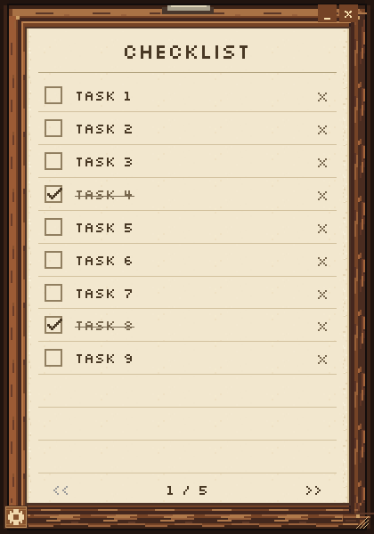

# Pixel Clipboard

A small Windows desktop checklist with a wooden pixel-art frame, parchment pages, and a bundled pixel font.

Maintained by **[atalamcom](https://github.com/atalamcom)**, with development assistance from **ChatGPT by OpenAI** including art and coding everything in this repo.

**Inspiration:** the clipboard idea from the **BiblioCraft** Minecraft mod.



## Install on Windows

Download **PixelClipboard-Setup-2.4.1.exe** from [Releases](https://github.com/atalamcom/pixel-clipboard/releases/latest).

The per-user installer adds Pixel Clipboard to Windows **Installed apps** and lets you choose **Start menu** and **desktop** shortcuts. It includes Java, so you do not need to install Java separately. You can also open **Settings → Windows Setup** inside the portable app to launch its nearby installer or visit the download page.

For a portable copy, download the ZIP from the same release, extract it, and launch `PixelClipboard.exe`. Keep its `app` and `runtime` folders alongside the executable.

## Use

- Click a task to edit it. Changes save automatically.
- Click unused paper below your tasks to create the next entry, even if the previous entry is empty.
- Press **Enter** to insert another task below the one you are editing.
- Press **Backspace** on an empty task to delete it. Use **Ctrl+Shift+Z** to undo.
- Click the heading to rename the checklist. Your title is saved.
- Use **>>** to create or open the next page. Pages remain available when you go back or reopen the app.
- Drag the wooden surround to move the window; drag its edges to resize it.
- Open the wooden gear at the lower-left for Settings, keep-on-top, and keyboard shortcuts.

Task text sits directly on the parchment. Entry tooltips and an Add button are unnecessary.

### Shortcuts

| Shortcut | Action |
| --- | --- |
| Enter | Insert and focus a task below the current task |
| Ctrl+N | Add a task on the current page |
| Backspace | Delete an empty task, or erase a character |
| Ctrl+Enter | Complete or reopen the task |
| Up / Down | Edit the previous or next task |
| Ctrl+Up / Ctrl+Down | Move the task |
| Ctrl+Shift+D | Delete the task |
| Ctrl+Shift+Z | Undo deletion |
| Ctrl+PageUp / Ctrl+PageDown | Previous / next page |
| Ctrl+P | Toggle keep-on-top |
| F1 | Open Settings |
| Escape | Finish task editing or cancel a title edit |

## Saved data

Your tasks, title, pages, and window preferences are stored in `%APPDATA%\PixelClipboard\state.json`. The app reads existing Pixel Clipboard saves, writes updates atomically, and maintains a recovery backup. Personal saves and generated files are excluded from this repository.

## Build

Use **Windows** and a **JDK 21 or newer**. Set `JAVA_HOME` to the JDK folder.

```bat
build.cmd jar
test.cmd
build.cmd
```

The first command creates `build\input\pixelclipboard.jar`. The last creates the self-contained Windows application in `dist\PixelClipboard\` using `jpackage`.

To create the Windows installer, put **WiX Toolset 3.14.1** on `PATH` or extract its portable tools to `.tooling\wix\`, then run:

```bat
package-installer.cmd
```

The installer is generated at `dist\PixelClipboard-Setup-2.4.1.exe`. `test.cmd headless` runs the data, shortcut, and layout checks without opening a window. Full tests use isolated test data.

## Project layout

```text
src/main/java/pixelclipboard/  Application source
src/main/resources/assets/    Clipboard artwork and app icons
src/main/resources/fonts/     Minecraft font and license
src/test/java/pixelclipboard/ Regression and window tests
scripts/                      Build, test, and installer commands
docs/                         Usage, development notes, screenshot
VERSION                       Version shared by the app and packaging
```

Build outputs, downloaded development tools, and earlier local prototypes are not tracked.

See [development notes](docs/DEVELOPMENT.md) and [third-party notices](THIRD_PARTY_NOTICES.md).
